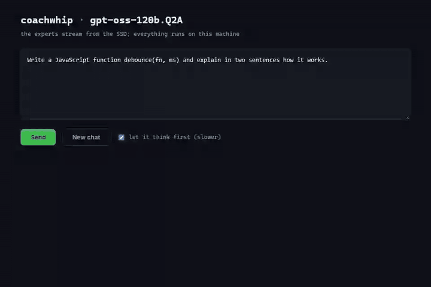
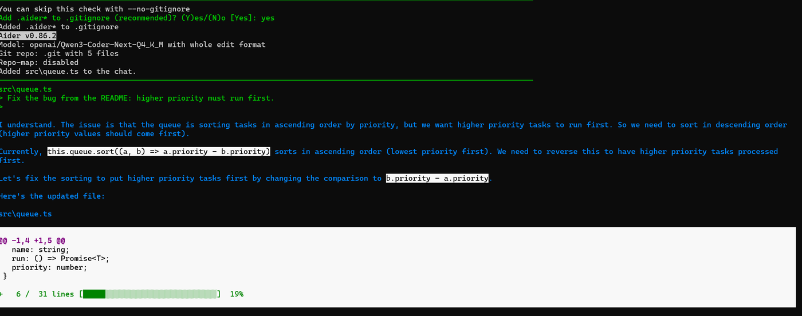

<p align="center"></p>

<p align="center">
  <a href="https://github.com/1picassoai/coachwhip/releases/latest"></a>
  <a href="LICENSE"></a>
  </p>

# Coachwhip

**The 80-billion-parameter Qwen3-Coder-Next on a 16 GB Mac, at about 13 tok/s. Fully offline. Nothing leaves your machine.**

```sh
curl -fsSL https://raw.githubusercontent.com/1picassoai/coachwhip/main/install.sh | bash
```

**You need:** a Mac with Apple silicon and 16 GB, macOS 26, and 30 GB of free disk. Not a Mac, or less than 16 GB: it will not run, and we would rather say so here than after the click.

**Then, two steps and you are talking to the coder:**

1. Download the ready-squeezed file, [`Qwen3-Coder-Next.Q2X.gguf`](HF_LINK) (29 GB, sha256 `cdc0584c1e4d30134cbb83f18e4c7607af90bd1145a64940c7a357b02a0216af`), and the model's [tokenizer.json](https://huggingface.co/Qwen/Qwen3-Coder-Next). Nothing to squeeze; it was squeezed once on our Mac with the same `coachwhip-prepare` you get in the install.
2. Start it. The chat opens in your browser:
   ```sh
   ~/coachwhip/coachwhip.sh ~/Downloads/Qwen3-Coder-Next.Q2X.gguf ~/Downloads/tokenizer.json 109 8090 --parallel --flash-reads --stand-ins
   ```

That is fast mode, about 13 tok/s on a real answer; drop `--stand-ins` for every expert read at about 5. Measured on a Mac mini M4 with 16 GB; the numbers and the quality check are in the [release notes](docs/releases/0.5.1.md).

**Also on a 16 GB Mac: OpenAI's gpt-oss-120b at about 10 tok/s.** It thinks before it answers. Four steps, because its official file is squeezed on your own Mac (106 GB free while it runs, 43 GB after):

1. Download the official [MXFP4 file](https://huggingface.co/ggml-org/gpt-oss-120b-GGUF) (63.4 GB) and the model's [tokenizer.json](https://huggingface.co/openai/gpt-oss-120b).
2. Squeeze it once, about 13 minutes:
   ```sh
   ~/coachwhip/target/release/coachwhip-prepare ~/Downloads/gpt-oss-120b-MXFP4.gguf ~/Downloads/gpt-oss-120b.Q2A.gguf
   ```
3. Delete the download; only the squeezed file is used: `rm ~/Downloads/gpt-oss-120b-MXFP4.gguf`
4. Start it. The chat opens in your browser:
   ```sh
   ~/coachwhip/coachwhip.sh ~/Downloads/gpt-oss-120b.Q2A.gguf ~/Downloads/tokenizer.json 25 8090 --parallel --flash-reads --stand-ins --max-tokens 8000
   ```

That is fast mode, about 10 tok/s; drop `--stand-ins` for every expert read at 4.2 tok/s. The other models, and what each needs: [docs/MODELS.md](docs/MODELS.md).

<p align="center"></p>

That is the real chat page on a Mac mini M4 with 16 GB, in real time: the model thinks, then writes. One line installs Coachwhip in under a minute; then download the model file once and squeeze it on your own Mac, as in [gpt-oss-120b](docs/MODELS.md#gpt-oss-120b). Qwen's MoE models run too: [docs/MODELS.md](docs/MODELS.md).

Coachwhip is one Rust binary. It takes a model file in GGUF format, keeps the part of the model every word needs on the GPU, and streams the rest from the SSD as each word asks for it. The model stays big; only its working set is in memory.

## Why we built it

Two reasons, and both had to hold at once.

**The code stays on the machine.** A coding assistant reads your code. If that assistant runs on someone else's server, your code goes there with every question. Coachwhip runs the model on your Mac, listens only to programs on your Mac, and sends nothing anywhere. Unplug the network and it works the same.

**It had to be fast enough to use.** A model big enough to be worth asking does not fit in a laptop's memory, and the usual answer, a smaller model, is a worse assistant. Coachwhip's answer is to stop loading the whole model. A mixture-of-experts model is made of many small experts, and a router picks only a few of them for each word. Coachwhip reads exactly those, keeps the ones it has used lately on the GPU, and guesses the next layer's picks while the GPU is busy on this one. The big model stays big; only its working set is in memory.

## Install

One line in Terminal:

```sh
curl -fsSL https://raw.githubusercontent.com/1picassoai/coachwhip/main/install.sh | bash
```

It checks your Mac and downloads the ready-built Coachwhip into `~/coachwhip`, in under a minute. Nothing to compile, no Rust. Run it again at any time to update to the latest release.

To build from source instead, run it with `COACHWHIP_FROM_SOURCE=1` in front of `bash`: it installs Apple's command line tools and Rust if they are missing, and the build takes about 10 minutes.

**What you need:** a Mac with Apple silicon (M4 or later recommended; M1 to M3 run it slower), 16 GB of memory, macOS 26 (tested), and disk for the model file. Coachwhip itself is 15 MB. Each model's disk and memory needs are on the [models page](docs/MODELS.md).

## Bring a model

Coachwhip is the engine; the model is yours. Download a supported model's GGUF file and its `tokenizer.json` from the publisher's page, then start Coachwhip with both. Some models are squeezed once on your Mac before first use; the models page has the steps and the exact start line for each one.

## Use

**Chat in your browser:**

```sh
~/coachwhip/coachwhip.sh /path/to/model.gguf /path/to/tokenizer.json 56
```

The last number is the bank, the expert slots kept on the GPU per layer (44 if you leave it out; each model's number is on the models page). The chat opens in your browser. Type, press Send, and the answer streams as it is written. Follow-up questions read only your new words; press **New chat** to start again. Stop Coachwhip with Ctrl+C.

**Thinking.** A model that thinks before it answers shows its thinking in a box above the answer. A model with an optional thinking mode shows a **let it think first** box on the page. Either way Coachwhip only puts the model's own template text at the start of its turn; each word comes at the same speed, and thinking makes the reply longer, not slower per word. In the terminal it is `--think`; through the API it is always off, so coding tools get the answer.

**From your coding tools:** while Coachwhip runs, it also speaks the OpenAI chat API, so any tool that takes an OpenAI base URL can use the model.

| Setting | Value |
|---|---|
| Base URL | `http://127.0.0.1:8090/v1` |
| API key | anything; it is ignored |
| Model | the model's file name, as listed at `/v1/models` |

A conversation holds up to 16K tokens: the history, the question and the answer together. That limit is sized to fit a 16 GB Mac; the models themselves support longer.

Only programs on this Mac can reach it. Follow-ups that resend the whole conversation read only the new part. The chat page and your tools share one model, one request at a time; when a tool has used it, the page's next question starts a new chat.

Tested with the official `openai` Python client and with [Aider](https://aider.chat), the coding agent for the terminal:

```sh
aider --openai-api-base http://127.0.0.1:8090/v1 --openai-api-key anything \
      --model openai/<model file name> --map-tokens 0 src/queue.ts
```

<p align="center"></p>

<p align="center"><sub>Aider on a Windows laptop, reaching the Mac through an SSH tunnel, so the requests arrive as a local program.</sub></p>

`--map-tokens 0` turns off Aider's repository map, which adds up to about a thousand tokens to each request by default; with it on, each request takes longer to read.

**One answer in the terminal:**

```sh
cd ~/coachwhip
./target/release/coachwhip --model /path/to/model.gguf --tokenizer /path/to/tokenizer.json --prompt "Write a Rust function that reverses a linked list."
```

**Useful options:**

| Option | What it does |
|---|---|
| `--chat 8090` | Serve the chat page on that port, on this machine only |
| `--max-tokens 4000` | Longest answer, thinking included |
| `--temperature 0` | Always pick the likeliest word (same answer every time) |
| `--bank 44` | Expert slots kept on the GPU per layer |
| `--prefetch 10` | Experts guessed and read in ahead, per layer; 0 turns the guess off |
| `--ahead 4` | How many layers ahead the guess looks |
| `--think` | Let a thinking model reason before it answers (`--prompt` runs) |
| `--parallel` | The GPU waits on a shared event for its experts; faster on big models, same answers |
| `--flash-reads` | Read experts straight from the SSD, past the page cache; same answers |
| `--experts 4` | Use fewer experts per word than the model was trained with; faster, the answers change |
| `--stand-ins` | Fast mode for models that support it: stand-ins for the light picks not in the bank; the answers change |
| `--profile` | Print where the time went after each answer |
| `--help` | Everything else |

## How it works

- **Streams experts, not files.** The small, always-used part of the model lives on the GPU. The experts stay on the SSD, and for each word Coachwhip reads exactly the experts the router picked.
- **An expert bank on the GPU.** Recently used experts stay in a bank in the GPU's memory and are reused, so the SSD is only touched for experts the bank does not hold.
- **The early guess.** While the GPU works on one layer, Coachwhip runs the router of a layer ahead on the same input, so it already knows most of the experts that layer will want, and reads them in while the GPU is busy. A guess that would land too late is dropped rather than evicting an expert still in use. The last few layers, which have no later router, use the routes the model has taken before, and every chat teaches that table more.
- **One GPU dispatch per layer.** All the experts a layer picked run together in a single fused kernel.
- **Reads while it computes.** When a prompt needs more experts than the bank holds, the GPU starts on each expert the moment its bytes land, while the rest are still being read.
- **Unified memory, used properly.** On Apple silicon the CPU and GPU share one memory, so an expert read from the SSD lands straight where the GPU reads it. No copies.
- **Stays inside your Mac.** Coachwhip picks the bank that fits, warns you when macOS is short, and if the GPU runs out of room it says so on the page and stops; close some apps, or start it again with a smaller `--bank`.

## Tell us how it ran

Good or bad, especially if it was slow, the fan worked hard, or it ran hot. [Open an issue](https://github.com/1picassoai/coachwhip/issues) with your Mac (chip and memory), macOS version, the model file, the `--bank` you used, and the speed line the chat page shows under each answer. Questions and ideas are welcome there too.

Release notes, every version: [docs/releases](docs/releases).

## Roadmap

- More MoE families: Mixtral, Qwen2-MoE, OLMoE, DeepSeek, GLM, Qwen3.8.
- Fused-attention GGUF files.
- An adapter that reads your own repository, on your own machine.
- More platforms.

## Credits

Built on [Candle](https://github.com/huggingface/candle); `vendor/candle-core` is its core crate with an MXFP4 kernel for Metal. gpt-oss-120b is [OpenAI's](https://huggingface.co/openai/gpt-oss-120b), under Apache-2.0. `crates/engine/src/model.rs` is derived from Candle's Qwen3 model, and the fused expert kernel is ggml's `mul_mv_id`, which ships inside Candle. The block-at-a-time linear attention follows [Gated Delta Networks](https://arxiv.org/abs/2412.06464) (Yang, Kautz and Hatamizadeh, ICLR 2025).

## Licence

Apache-2.0. See [LICENSE](LICENSE).
