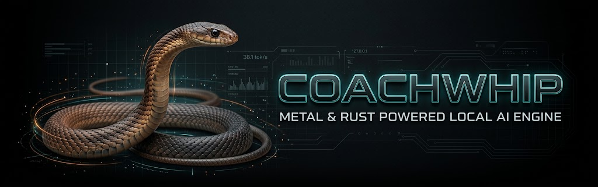

<p align="center"></p>

<p align="center">
  <a href="https://github.com/1picassoai/coachwhip/releases/latest"></a>
  <a href="LICENSE"></a>
  
  
  <a href="https://github.com/1picassoai/coachwhip/actions/workflows/release-build.yml"></a></p>

# Coachwhip

## **Qwen3.6-35B on a 16 GB Mac. 38 tok/s. Fully offline.**

**Install:** under a minute. **Model:** one 11.5 GB download. **Runtime:** every expert held in GPU memory, nothing streamed from the SSD.

### Requirements

- Apple silicon (M1 or later)
- 16 GB of memory
- macOS 15 or later
- 15 GB of free disk

### Integrity (16 Oct 2026)

The v0.5.3 download was scanned by 62 antivirus engines on VirusTotal. None flagged it.

- [VirusTotal: the v0.5.3 download](https://www.virustotal.com/gui/file/8aa8dfe2ccd4323c5057079914d9e7c2c49c729be9d4949b8d91860c96b9aba1)
- [VirusTotal: the `coachwhip` program inside it](https://www.virustotal.com/gui/file/4d782084b4ac3aa80c62d270091f8209e836620faf6c164ea57c228daa0ec7b2)

### Quick start

**1. Install Coachwhip**

```sh
curl -fsSL https://raw.githubusercontent.com/1picassoai/coachwhip/main/install.sh | bash
```

**2. Download the model.** Unsloth's 11.5 GB UD-IQ2_M file, used as it is:

```sh
mkdir -p ~/coachwhip/models && cd ~/coachwhip/models
curl -L -O https://huggingface.co/unsloth/Qwen3.6-35B-A3B-GGUF/resolve/main/Qwen3.6-35B-A3B-UD-IQ2_M.gguf
curl -L -O https://huggingface.co/Qwen/Qwen3.6-35B-A3B/resolve/main/tokenizer.json
```

**3. Run.** Starts the engine and opens the chat in your browser:

```sh
~/coachwhip/coachwhip.sh ~/coachwhip/models/Qwen3.6-35B-A3B-UD-IQ2_M.gguf ~/coachwhip/models/tokenizer.json 44 8090 --max-tokens 16000
```

`44` is the bank, the expert slots kept on the GPU; this model fits whole, so any number works. `8090` is the port.

The file fits in memory, so Coachwhip keeps all 256 experts of all 40 layers on the GPU instead of streaming them from the SSD.

### Use it from your tools

- **OpenAI-compatible API:** `http://127.0.0.1:8090/v1`, any key, model `Qwen3.6-35B-A3B-UD-IQ2_M`.
- **Aider:**

  ```sh
  aider --openai-api-base http://127.0.0.1:8090/v1 --openai-api-key anything --model openai/Qwen3.6-35B-A3B-UD-IQ2_M --map-tokens 0
  ```

- **Sampling:** each request's `temperature`, `top_p`, `top_k` and `min_p` are honoured. Without them the model gets Qwen's own 0.7 / 0.8 / 20 / 0.
- **Bigger models:** the 80B coder and gpt-oss-120b stream their experts from the SSD; see the [models page](docs/MODELS.md).

### Measured (Mac mini M4, 16 GB)

- **Writing:** 38 tok/s
- **Reading the prompt:** about 300 tok/s on a 1,500-token prompt

Your Mac and your prompt move the numbers; the [release notes](docs/releases/0.5.3.md) say how they were measured. The squeezed `Q2X` file from 0.5.2 still runs the streaming way, at its own numbers.

---

## Our promise

**We built Coachwhip for ourselves first: a fast, private way to run a big coding model on a Mac. It worked well enough that we wanted everyone to have it, so we made it open source.**

**We're a small team in England, UK, and we'll keep supporting Coachwhip for as long as people use it. Every issue gets read and answered, and every real bug gets fixed. A full roadmap of the features we're working on is coming soon.**

## Why we built it

Two reasons, and both had to hold at once.

**The code stays on the machine.** A coding assistant reads your code. If that assistant runs on someone else's server, your code goes there with every question. Coachwhip runs the model on your Mac, listens only to programs on your Mac, and sends nothing anywhere. Unplug the network and it works the same.

**It had to be fast enough to use.** A model big enough to be worth asking does not fit in a laptop's memory, and the usual answer, a smaller model, is a worse assistant. Coachwhip's answer is to stop loading the whole model. A mixture-of-experts model is made of many small experts, and a router picks only a few of them for each word. Coachwhip reads exactly those, keeps the ones it has used lately on the GPU, and guesses the next layer's picks while the GPU is busy on this one. The big model stays big; only its working set is in memory.

## Use

**Chat in your browser:**

```sh
~/coachwhip/coachwhip.sh /path/to/model.gguf /path/to/tokenizer.json 56
```

The last number is the bank: expert slots kept on the GPU per layer. Each model's number is on the [models page](docs/MODELS.md). Ctrl+C stops it.

- A thinking model shows its thinking in a box above the answer. Through the API thinking is off, so coding tools get the answer.
- A conversation holds up to 16K tokens, sized for a 16 GB Mac.
- Only programs on this Mac can reach it. The chat page and your tools share one model, one request at a time.
- Tested with the official `openai` Python client and with [Aider](https://aider.chat). `--map-tokens 0` turns off Aider's repository map, which adds about a thousand tokens to every request.

<p align="center"></p>

**One answer in the terminal:**

```sh
cd ~/coachwhip
./target/release/coachwhip --model /path/to/model.gguf --tokenizer /path/to/tokenizer.json --prompt "Write a Rust function that reverses a linked list."
```

**Useful options:**

| Option | What it does |
|---|---|
| `--chat 8090` | Serve the chat page on that port, on this machine only |
| `--max-tokens 4000` | Longest answer, thinking included |
| `--temperature 0` | Always pick the likeliest word (same answer every time) |
| `--bank 44` | Expert slots kept on the GPU per layer |
| `--prefetch 10` | Experts guessed and read in ahead, per layer; 0 turns the guess off |
| `--ahead 4` | How many layers ahead the guess looks |
| `--think` | Let a thinking model reason before it answers (`--prompt` runs) |
| `--parallel` | The GPU waits on a shared event for its experts; faster on big models, same answers |
| `--flash-reads` | Read experts straight from the SSD, past the page cache; same answers |
| `--experts 4` | Use fewer experts per word than the model was trained with; faster, the answers change |
| `--stand-ins` | Fast mode for models that support it: stand-ins for the light picks not in the bank; the answers change |
| `--profile` | Print where the time went after each answer |
| `--help` | Everything else |

## Tell us how it ran

Good or bad, especially if it was slow, the fan worked hard, or it ran hot. [Open an issue](https://github.com/1picassoai/coachwhip/issues) with your Mac (chip and memory), macOS version, the model file, the `--bank` you used, and the speed line the chat page shows under each answer. Questions and ideas are welcome there too.

Release notes, every version: [docs/releases](docs/releases).

## Roadmap

What's next, while the full roadmap is being written:

- More MoE families: Mixtral, Qwen2-MoE, OLMoE, DeepSeek, GLM, Qwen3.8.
- Fused-attention GGUF files.
- An adapter that reads your own repository, on your own machine.
- More platforms.

## Credits

Built on [Candle](https://github.com/huggingface/candle); `vendor/candle-core` is its core crate with an MXFP4 kernel for Metal. gpt-oss-120b is [OpenAI's](https://huggingface.co/openai/gpt-oss-120b), under Apache-2.0. `crates/engine/src/model.rs` is derived from Candle's Qwen3 model, and the fused expert kernel is ggml's `mul_mv_id`, which ships inside Candle. The block-at-a-time linear attention follows [Gated Delta Networks](https://arxiv.org/abs/2412.06464) (Yang, Kautz and Hatamizadeh, ICLR 2025).

To build from source instead of taking the ready-built binary, run the install line with `COACHWHIP_FROM_SOURCE=1` in front of `bash`; it installs Apple's command line tools and Rust if they are missing, about 10 minutes.
